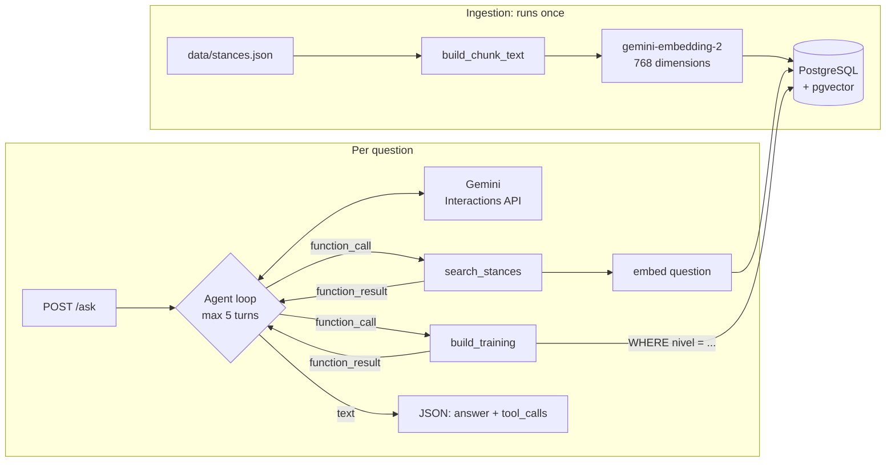

# Kung Fu Agent

A retrieval-augmented agent that answers questions about Choy Lay Fut kung fu stances and builds training sessions by level, using Gemini function calling, PostgreSQL with pgvector, and FastAPI.

## How it works



**Ingestion.** Each stance in `data/stances.json` becomes one chunk of text in the `title: ... | text: ...` format, gets embedded, and is upserted into a `stances` table.

**Questions.** The model receives the question and two tool descriptions. It decides whether to call a tool, the code runs it and sends the result back, and the loop repeats until the model answers in text:

- `search_stances(query)`: semantic search using cosine distance (`<=>`). Use for "which stance helps with X" questions.
- `build_training(level, count)`: exact filter by level. Use for "build me a training session" requests.

## Stack

- Python 3.14 and [uv](https://docs.astral.sh/uv/)
- Gemini through the `google-genai` SDK: the Interactions API for the agent and `gemini-embedding-2` for embeddings
- PostgreSQL 17 with [pgvector](https://github.com/pgvector/pgvector), via Docker Compose
- psycopg 3
- FastAPI and Pydantic
- pytest

No agent framework (LangChain or similar). The loop fits in one function, and writing it by hand was the point: every request, tool call and error is visible in the code.

## Getting started

Prerequisites: Docker, uv, and a [Gemini API key](https://aistudio.google.com/apikey).

```bash
git clone https://github.com/mariacesarotti/kung-fu-agent.git
cd kung-fu-agent
cp .env.example .env          # then fill in GEMINI_API_KEY
uv sync
docker compose up -d
uv run --env-file .env src/kung_fu_agent/ingest.py
uv run --env-file .env fastapi dev src/kung_fu_agent/api.py
```

The ingestion prints `10 posturas processadas, 10 linhas na tabela.` and can be run again safely. The interactive docs are at http://127.0.0.1:8000/docs.

### Environment variables

| Variable | Purpose |
|---|---|
| `GEMINI_API_KEY` | Gemini API key |
| `AGENT_MODEL` | Model used by the agent (default: `gemini-3.5-flash-lite`) |
| `POSTGRES_USER`, `POSTGRES_PASSWORD`, `POSTGRES_DB`, `POSTGRES_PORT` | Database connection, shared with Docker Compose |

## Example

The agent answers in Brazilian Portuguese.

```bash
curl -X POST http://127.0.0.1:8000/ask \
  -H "Content-Type: application/json" \
  -d '{"question": "Quais posturas trabalham equilíbrio?"}'
```

```json
{
  "answer": "As seguintes posturas trabalham o equilíbrio no Choy Lay Fut:\n\n* **Dok Lap Ma**: Base sobre uma perna só, com a outra recolhida e o joelho elevado à altura do quadril. Beneficia o equilíbrio estático, propriocepção, força do core, estabilidade do tornozelo e do quadril de apoio.\n* **Diu Ma**: Base curta com quase todo o peso na perna de trás, enquanto a perna da frente toca o chão só com a ponta do pé. Trabalha o equilíbrio sobre uma perna, força excêntrica da perna de apoio e estabilidade de tornozelo.\n* **Jau Ma**: Deslocamento entre bases. Trabalha o equilíbrio dinâmico, agilidade e controle de distância (Nota: esta postura possui nível de confiança **baixo**, o que significa que o nome ou a descrição podem variar entre escolas; vale confirmar com o professor).",
  "tool_calls": [
    {"name": "search_stances", "arguments": {"query": "trabalham equilíbrio"}}
  ]
}
```

The note on Jau Ma comes from the `confianca` field: stances whose names vary between schools are flagged in the data, and the system instruction tells the agent to warn about them.

### Status codes

| Status | When |
|---|---|
| 200 | Answer generated. Tool failures are sent back to the model, which explains them. |
| 422 | Missing, empty or whitespace-only question, or longer than 500 characters |
| 502 | The model rejected the request (for example, an invalid API key) |
| 503 | Database down, or model overloaded, rate limited or timed out |

Error responses carry a generic message. Details go to the server log only.

## Tests

```bash
uv run pytest
```

52 tests, about 1 second. They run without Docker, without `.env` and without network access: Gemini and the database are replaced by mocks. They cover chunking, input validation, the tool dispatcher (including rollback on database errors), the agent loop (no tool, one tool, turn limit, Gemini errors) and the API.

## Project structure

```
data/stances.json            10 stances: name, description, benefits, muscles, level, confidence
src/kung_fu_agent/
  chunking.py                stance -> text to embed (pure function)
  embeddings.py              embed_text, EMBEDDING_DIM
  db.py                      connection with the vector extension and type registered
  ingest.py                  table creation and idempotent upsert
  search.py                  semantic search
  training.py                level filter with argument validation
  tools.py                   tool declarations and dispatcher
  agent.py                   agent loop
  api.py                     FastAPI app
tests/
```

## Design decisions

**768 dimensions instead of the default 3072.** The pgvector HNSW index supports up to 2000 dimensions for the `vector` type, and 768 uses 4x less storage per row. With 10 stances that are quite different from each other, the extra precision brings no visible gain. `EMBEDDING_DIM` lives in one place and defines the column, the document embeddings and the question embeddings.

**No vector index.** With 10 rows, exact search is instant and has perfect recall. HNSW only pays off with thousands of rows.

**Different prefixes for documents and questions.** Documents use `title: ... | text: ...` and questions use `task: search result | query: ...`, as recommended for `gemini-embedding-2`.

**A 0.40 distance threshold.** Search always returns results, even for unrelated questions. In tests, relevant questions had their best match between 0.27 and 0.33, while "receita de bolo de cenoura" (a carrot cake recipe) came back at 0.48. The system instruction tells the agent to treat anything above 0.40 as "not found". The threshold is provisional and based on a small sample.

**Idempotent ingestion.** `INSERT ... ON CONFLICT (id) DO UPDATE`: running it twice keeps 10 rows, and a stance corrected in the JSON is updated. The extension and the table are created by code, so `docker compose down -v` followed by ingestion rebuilds everything.

**Model arguments are untrusted.** `build_training` normalizes case and accents (`"Intermediário"` becomes `intermediario`), caps `count` at 10, and rejects what cannot be guessed (`"mestre"`, `-1`, `2.5`). Errors go back to the model with `is_error`, so it can correct itself, and the loop never crashes on a bad tool call.

**A turn limit.** The loop stops after 5 model calls. A model that keeps requesting tools cannot drain the API quota.

**Tools and system instruction on every call.** With the Interactions API, `previous_interaction_id` carries only the conversation history. Tools, system instruction and generation config apply only to the request that sends them.

**A 60-second timeout.** The SDK silently retries 408, 409, 429 and 5XX responses with backoff. During development, an overloaded model (503) looked like a hang. The timeout turns that into an error within a minute.

**One Gemini client per app, one database connection per request.** The client is created in the FastAPI `lifespan` and reused. Connections come from a dependency with `yield`, so concurrent requests never share a transaction. No connection pool: opening a connection takes milliseconds, against several seconds for the model.

**A sync endpoint.** The agent is blocking (sync SDK, sync psycopg). With `async def`, a 15-second request would block the event loop and every other request. With `def`, FastAPI runs each request in a thread pool: two parallel requests of 10.7 s and 16.9 s finished in about 17 s, instead of 27.6 s.

**A private import, isolated.** The `google-genai` SDK does not export the Interactions API errors publicly. `agent.py` imports them from the private module in one place and converts them into `ModelError`. The rest of the project only knows `ModelError`.

## Limitations

- Only 10 stances. Names and descriptions vary between Choy Lay Fut schools, which is why each stance has a confidence level.
- Each question takes about 10 to 20 seconds.
- No authentication or rate limiting. Exposed publicly, anyone could spend the API quota.
- On the Gemini API free tier, Google may use the submitted content to improve its products.

## What I learned

**Embeddings are a design decision.** Choosing what goes into each chunk changed what the search could find. I learned to write the chunk text for the model to read, not for Python to print: a list turned into `['strength', 'balance']` is noise, and a field left out of the text simply doesn't exist for the search.

**Similarity search never says "I don't know".** My first test included a carrot cake recipe on purpose. It still came back with three stances, just further away (0.48 against 0.27 to 0.33 for real questions). That number became the threshold in the agent's instructions. I liked deciding something from my own measurements instead of guessing.

**The model only asks.** Function calling clicked when I saw that the model never runs anything. It sends a name and some arguments, and those arguments can be wrong, so I validate them like any other user input. Returning errors to the model, instead of crashing, lets it correct itself.

**Read the docs.** I assumed `previous_interaction_id` kept the whole conversation, including the tools and the system instruction. It only keeps the history. Missing that one sentence would have made the final answer ignore all my rules.

**A hang is an error you can't see yet.** At one point the agent just stopped responding. Testing the call in isolation, outside the project, and then through a different API finally showed the real message: the model was overloaded, and the SDK was retrying quietly. Now every call has a timeout, and I test new pieces alone before connecting them.

**Sync code needs a sync endpoint.** With `async def`, one slow request would block the whole server. With `def`, two parallel requests finished in about 17 seconds instead of 27. I knew the theory, but measuring it made it stick.

**Testable code is a choice made early.** Passing the database connection and the Gemini client as parameters felt like extra work in the beginning. It paid off when I wrote 52 tests that run in about a second with no network. Breaking the code on purpose and watching the right test fail was the moment I trusted them.